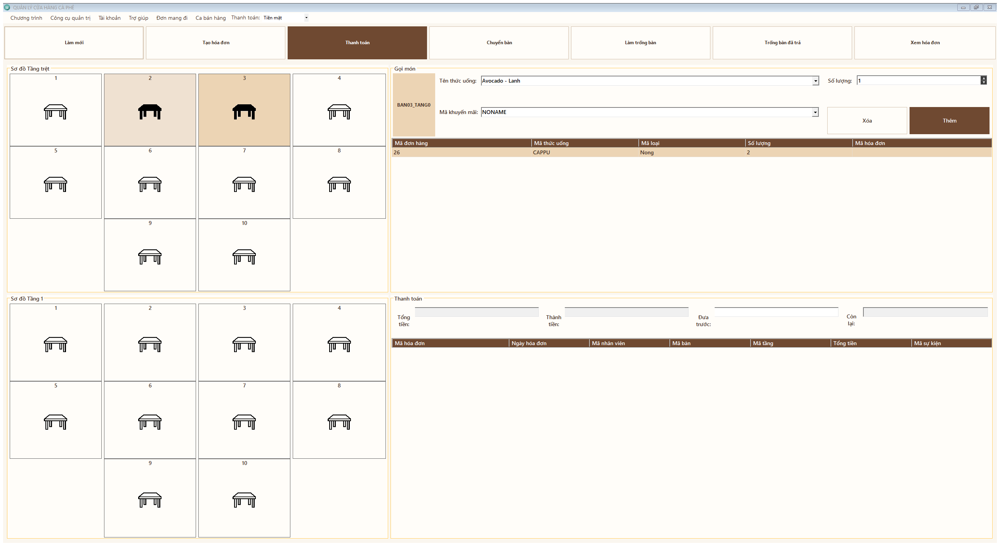
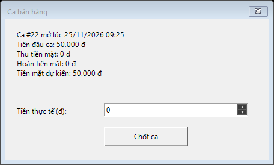

# QuanLyQuanCaPhe

Ứng dụng Windows quản lý quán cà phê và quán nước nhỏ, dùng WinForms, .NET 10, Entity Framework 6 và SQL Server.

## Nghiệp vụ

- Gọi món theo bàn hoặc mang đi; lưu nhiều đơn chưa thanh toán và khôi phục sau khi mở lại.
- Chuyển đơn chưa thanh toán sang bàn trống; chỉ quản trị viên được hủy toàn bộ đơn.
- Áp dụng khuyến mãi; thanh toán tiền mặt hoặc chuyển khoản đã được nhân viên xác nhận thủ công.
- Lưu giá từng món khi thanh toán; xem chi tiết và in lại qua hộp thoại máy in Windows.
- Quản trị viên hoàn toàn bộ hóa đơn, có lý do và lịch sử; báo cáo loại trừ các hóa đơn đã hoàn.
- Mở một ca tại một thời điểm, ghi tiền đầu ca, thu và hoàn tiền mặt, tiền kiểm đếm cuối ca và chênh lệch.
- Quản lý thức uống, khuyến mãi, nhân viên và khóa đăng nhập nhân viên nghỉ việc.

## Cài đặt và nâng cấp

- Windows, .NET 10 SDK (hoặc SDK mới hơn hỗ trợ `net10.0-windows`) và SQL Server 2016 SP1 trở lên hoặc SQL Server LocalDB.
- Ứng dụng tiếp tục sử dụng Entity Framework 6 và cơ sở dữ liệu SQL Server hiện có.
- **Sao lưu cơ sở dữ liệu trước khi nâng cấp.** Chọn đúng cơ sở dữ liệu `CafeRestaurant`, sau đó chạy lần lượt [migrate-order-uniqueness.sql](QuanLyQuanCafe/migrate-order-uniqueness.sql), [migrate-identifiers.sql](QuanLyQuanCafe/migrate-identifiers.sql), [migrate-invoice-prices.sql](QuanLyQuanCafe/migrate-invoice-prices.sql), [migrate-cafe-operations.sql](QuanLyQuanCafe/migrate-cafe-operations.sql), [migrate-draft-orders.sql](QuanLyQuanCafe/migrate-draft-orders.sql) và [migrate-takeaway.sql](QuanLyQuanCafe/migrate-takeaway.sql). Không chạy các tập lệnh tạo cơ sở dữ liệu mới trên dữ liệu đang sử dụng.
- Với cơ sở dữ liệu mới, chạy **một trong hai** tập lệnh tương đương [SQL Script.sql](SQL%20Script.sql) hoặc [Full Script.sql](Full%20Script.sql); cả hai đã gồm schema hiện tại và dữ liệu mẫu, không cần chạy migration. Tập lệnh từ chối chạy nếu `CafeRestaurant` đã tồn tại. Nếu chạy trong SSMS và nhận cảnh báo này, chạy `SET NOEXEC OFF` trước khi tiếp tục sử dụng cùng kết nối.
- Chỉnh chuỗi kết nối `CafeRestaurantEntities` trong [App.config](QuanLyQuanCafe/QuanLyQuanCafe/App.config) cho phù hợp máy chủ trước khi build; cấu hình mặc định dùng `(localdb)\MSSQLLocalDB`. Không đưa mật khẩu vào mã nguồn hoặc kho Git.
- Build bằng `dotnet build QuanLyQuanCafe\QuanLyQuanCafe.sln -c Release`. Cấu hình trong thư mục xuất bản là `QuanLyQuanCafe.dll.config`.

## Kiểm thử

Trên Windows có SQL Server LocalDB và `sqlcmd`, chạy `.\tests\CafeIntegration\run.ps1`. Tập lệnh tạo LocalDB và thư mục tạm riêng, kiểm tra cả hai tập lệnh tạo mới và bảo vệ cơ sở dữ liệu đã tồn tại, sau đó mô phỏng schema cũ, chạy các migration hai lần và kiểm tra giá cũ, ca, hoàn tiền, đơn nháp và mang đi. Tài nguyên thử nghiệm được xóa sau khi chạy; không chạy trên cơ sở dữ liệu đang sử dụng.

## Sử dụng

1. Đăng nhập và chọn **Ca bán hàng** để mở ca, nhập tiền mặt đầu ca.
2. Chọn bàn hoặc **Đơn mang đi**, thêm món và tạo hóa đơn. Chọn bàn khác không làm mất đơn đang chờ.
3. Chọn phương thức trên thanh menu. Với chuyển khoản, kiểm tra tiền đã nhận trước khi xác nhận; ứng dụng không kết nối ngân hàng.
4. Nhấn **Thanh toán**. Trong chi tiết hóa đơn, chọn **In hóa đơn** nếu cần; hủy hộp thoại in không hủy thanh toán.
5. Để hoàn tiền, quản trị viên chọn **Xem hóa đơn**, chọn hóa đơn rồi **Hoàn toàn bộ hóa đơn** và nhập lý do. Hóa đơn cũ không lưu phương thức thanh toán cần chọn thủ công phương thức hoàn.
6. Cuối ca, chọn **Ca bán hàng**, nhập tiền mặt kiểm đếm và chốt ca. Tiền dự kiến bằng tiền đầu ca cộng tiền mặt bán hàng trừ tiền mặt hoàn trong ca; chênh lệch là tiền kiểm đếm trừ tiền dự kiến.

Trong quản lý nhân viên, chọn nhân viên, thay đổi ô **Còn làm** và nhấn **Lưu trạng thái** để khóa hoặc mở lại quyền đăng nhập.

## Giới hạn hiện tại

- Chỉ hỗ trợ một cửa hàng, một máy; trạng thái bàn đã thanh toán chỉ tồn tại trong phiên. Đơn mang đi không chiếm bàn phục vụ và không chuyển bàn.
- Hóa đơn cũ không có đơn giá từng món sẽ hiển thị **không có dữ liệu giá**; không ước tính từ giá hiện tại. Tên món trong chi tiết được lấy từ danh mục hiện tại.
- Báo cáo doanh thu và món bán chạy loại trừ toàn bộ hóa đơn đã hoàn, kể cả khi xem lại kỳ bán ban đầu. Chưa hỗ trợ hoàn một phần, quản lý kho hoặc tích điểm.
- Nhân viên không còn làm hoặc chưa có trạng thái không thể đăng nhập; tài khoản quản trị không bị áp dụng quy tắc này.
- Mã hiện có giới hạn 9.999 hóa đơn và 9.999 dòng đơn hàng mỗi ngày. Hãy kiểm thử với bản sao dữ liệu và quy trình thực tế trước khi sử dụng chính thức.

## Giao diện

Ảnh chụp với dữ liệu thử nghiệm:

## Tác giả

Nếu có góp ý, đề xuất, vui lòng liên hệ email sau:
La Quốc Thắng - quocthang_0507@yahoo.com.vn